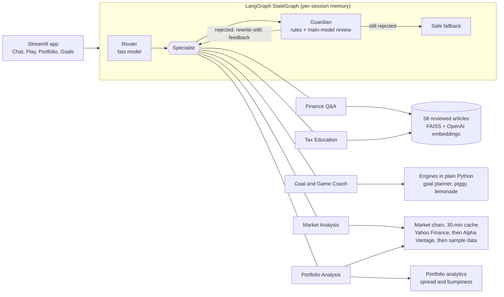

# Penny the pig: an AI money coach for kids

Penny is a multi-agent money-literacy app for children aged about 8 to 13. A child chats with Penny,
plays two money games, keeps a practice stock portfolio with real prices, and plans a savings goal.
Every answer is grounded in a reviewed article, a tool result or a live price, and is checked by an
independent Guardian before the child sees it. Penny teaches; it never gives financial advice.

It was built as the capstone for the "AI Finance Assistant" project, re-imagined for a 12-year-old.

## What it does

| Tab | What the child can do |
|---|---|
| **Chat** | Ask money questions in their own words. Each answer shows its sources and a plain-words trace of how it was made |
| **Play** | Piggy Bank (save from a weekly allowance toward a goal) and Lemonade Stand (price, cups and weather decide the profit) |
| **Portfolio and Markets** | Edit a practice portfolio and see its value, biggest share and bumpiness, with an allocation chart. Look up a company's live price with a 30-day chart |
| **Goals** | Pick a goal, see how much to save each week (with optional interest), a week-by-week chart, and a family conversation prompt |

A three-question quiz at the start sets the reading level (starter, saver or builder). Coins, XP and
a weekly saving streak sit in the sidebar.

## Architecture



- **Router** (`agents/router.py`): the fast model picks one specialist, using the last two exchanges so
  follow-ups like "what about Nike?" work. A two-part question is answered for its main part, and the
  other part is offered as an "Also ask" button. If the model fails, a keyword router decides.
- **Specialists** are real agents with their own tools. Finance Q&A and Tax answer only from the
  articles (retrieval-augmented generation, with citations). The Coach, Market and Portfolio agents
  must get every number from a tool: a reply with a number and no successful tool behind it is
  replaced in code.
- **Guardian** (`agents/guardian.py`) sees only the question, the evidence and the draft. Rules run
  first (advice wording, promises, length, format), then a model review (one-sided claims,
  unsupported facts, unkind or too-hard wording, privacy). It fails closed: if the review fails, the
  draft is never shown.
- **LLM adapter**: agents talk to a provider-neutral `LLMClient`; Anthropic and OpenAI adapters
  implement it (`docs/LLM.md`).

The full workflow graph, the agent loop and each agent's rules are in
[docs/ARCHITECTURE.md](docs/ARCHITECTURE.md).

## Quick start

You need Python 3.12 and [uv](https://docs.astral.sh/uv/).

```bash
make setup                 # install dependencies
cp .env.example .env       # then add your keys (never commit .env)
make kb-index              # build the article index (needs OPENAI_API_KEY)
make run                   # open the app at http://localhost:8501
```

In `.env`, set `LLM_PROVIDER` to `openai` or `anthropic` and add that provider's key.
`OPENAI_API_KEY` is also used for article search. `ALPHAVANTAGE_API_KEY` is optional: it is the
backup when Yahoo Finance is down (free tier, 25 requests a day).

**No keys?** The app still opens. The chat runs in an offline demo mode with placeholder answers and
says what is missing; the games, goals and portfolio tabs work fully, with sample prices if the
network is unavailable.

## Commands

| Command | What it does |
|---|---|
| `make run` | Start the app |
| `make test` | Run the 818 tests (no keys or network needed) |
| `make cov` | Tests with line and branch coverage; fails below 90% |
| `make lint`, `make fmt` | Ruff checks and formatting |
| `make evals` | Live evals against the real models, prices and index; writes `docs/evals/report.md` |
| `make kb-check` | Check every article: format, length, reading grade, advice wording |
| `make kb-index` | Rebuild the search index from reviewed articles |
| `make kb-ask Q="what is a bond?"` | Search the articles from the terminal |
| `make demo-live Q="what is a stock?"` | One question through the whole graph, with the trace |

## Quality

- **Tests:** 818 tests, 99% line and branch coverage, all hermetic (no keys, network or `.env`).
  The Streamlit pages are tested headlessly with `AppTest`.
- **Evals** ([latest report](docs/evals/report.md), two rounds, gpt-4o-mini router and gpt-4o writer
  and reviewer):

  | Suite | Result |
  |---|---|
  | Routing (21 questions, including follow-ups and two-part questions) | 42/42 |
  | Guardian (13 planted drafts: advice, promises, privacy, too hard...) | 26/26: every bad draft caught, every good one approved |
  | Retrieval (66 questions with a known best article, plus 2 off-topic, over 58 articles) | 66/68 |
  | Whole answers (17 questions through the graph, every agent) | 34/34 approved, 0 safe fallbacks |

- **Knowledge base:** 58 original articles at a grade-6 reading level across 10 areas (saving,
  interest, earning, budgeting, markets, risk, companies, taxes, safety, mindset), each with public
  government sources, all reviewed by a parent before indexing (`docs/KB_GUIDE.md`).

## Safety and privacy

- **Education, not advice.** No agent says what to buy or sell, and none predicts a price. "Should I
  buy Tesla?" gets an explanation of risk, from the stock article.
- **Grounded.** Answers come from reviewed articles, tool results or live prices. Sample prices are
  always labelled as sample data.
- **Checked.** Every reply passes the Guardian, or the child gets a kind fallback instead.
- **Private.** Penny stores a nickname only, never a real name, and never asks about family income
  or balances. Questions are sent to the chosen LLM provider, and to OpenAI for search embeddings.
  Progress lives in the browser session only.

## Project layout

```
src/penny/
  agents/     router, specialists, Guardian, agent loop, grounding rules, prompts
  graph/      the LangGraph workflow and its interfaces
  engines/    pure-Python games, goal planner and portfolio analytics (no AI)
  kb/         article parsing, checks, chunking, embeddings, FAISS index, retrieval
  market/     Yahoo Finance, Alpha Vantage and sample providers, fallback chain, cache
  llm/        provider-neutral client, Anthropic and OpenAI adapters
  evals/      the eval suites and report
  ui/         the Streamlit app
data/
  kb/         topics.yaml and the articles
  evals/      eval cases as YAML
  principles.yaml   Penny's values, used in every prompt
docs/         architecture, plan, KB guide, philosophy, LLM setup, demo script, eval report
tests/        unit, graph, UI and eval tests
```

## How it maps to the rubric

| Rubric area | Where |
|---|---|
| Multi-agent architecture | Router, five specialists and the Guardian (`src/penny/agents/`) |
| LangGraph workflow | `src/penny/graph/build.py`: router, specialists, Guardian rewrite loop, fallback, per-session checkpointer |
| RAG with source attribution | `src/penny/kb/`, Finance Q&A and Tax agents; every answer lists its articles and their sources |
| Real-time data | `src/penny/market/`: Yahoo Finance with Alpha Vantage fallback, 30-minute cache, sample data offline |
| Multi-tab UI, conversation, charts | `src/penny/ui/`: four tabs, chat history and follow-ups, allocation, price, goal and profit charts |
| Knowledge base | 58 reviewed articles, `data/kb/` |
| Portfolio analysis, market intelligence | `engines/portfolio.py`, Portfolio and Market agents, the Portfolio and Markets tab |
| Code quality, docs, testing | This README, `docs/`, 818 tests at 99% coverage, live evals |

Left out by choice: an MCP server (5 rubric points) and a sixth News agent. The time went into the
Guardian, the grounding rules and the evals instead.

## Limitations and roadmap

- **Saved progress.** Progress and traces live in memory. A Postgres store (already in the plan, with
  `DATABASE_URL` in `.env.example`) would keep progress between visits and power a parent view of the
  traces. The database dependencies are installed but not wired yet.
- **The starter reading level.** The Guardian is sometimes stricter than needed for the youngest
  readers, so an occasional answer ends in the safe fallback. It fails safe; the evals track it.
- **Ten more planned articles**, mostly advanced investing (ETFs, index funds, market cap...).
- **Ideas:** a News agent that explains one kid-relevant headline a week, voice input for younger
  readers, a parent dashboard with weekly progress, and Spanish articles.

## Docs

| Doc | What is in it |
|---|---|
| [ARCHITECTURE.md](docs/ARCHITECTURE.md) | The workflow, each agent, the Guardian, the app, evaluation |
| [DEMO.md](docs/DEMO.md) | A 7-minute demo script |
| [PHILOSOPHY.md](docs/PHILOSOPHY.md) | The four ideas behind Penny and where each shows up |
| [KB_GUIDE.md](docs/KB_GUIDE.md) | Article format, writing rules, review checklist, search |
| [LLM.md](docs/LLM.md) | Choosing a provider and models |
| [PLAN.md](docs/PLAN.md) | How the work was split into small PRs |
| [evals/report.md](docs/evals/report.md) | The latest eval results |
