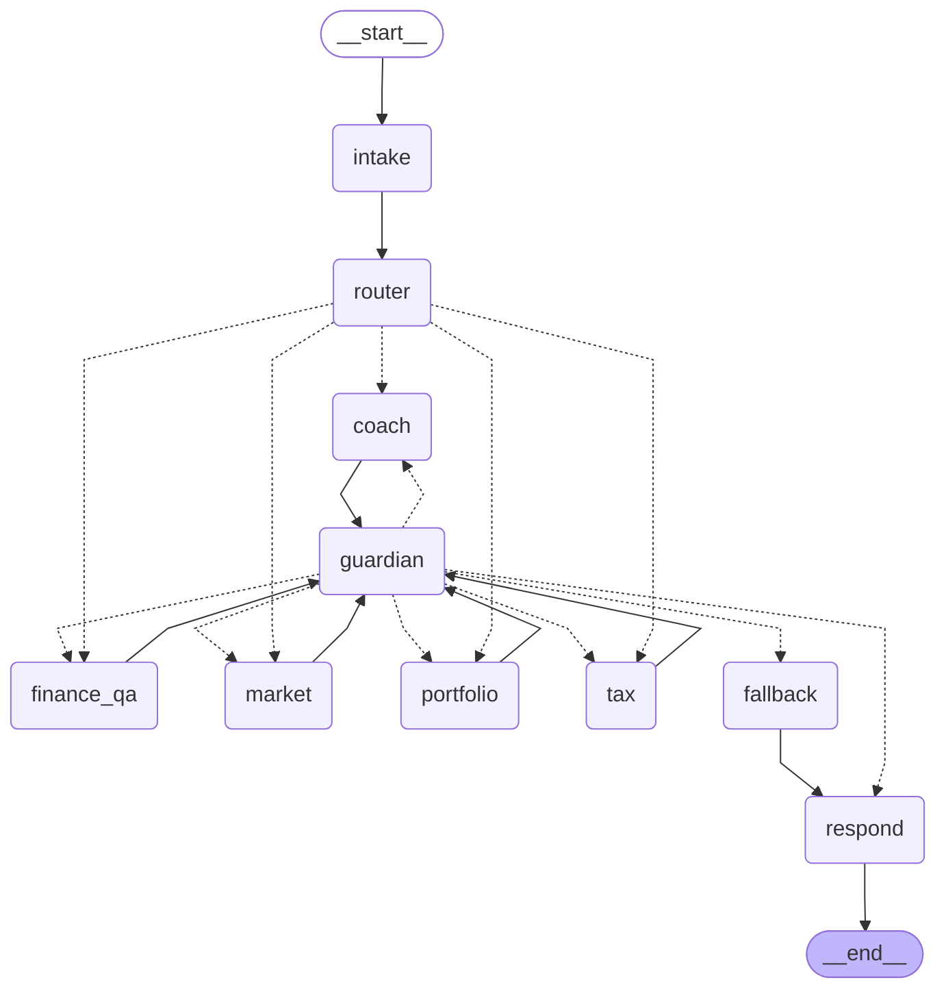

# Architecture: the Penny workflow

One LangGraph `StateGraph` handles every question a child asks. Real decisions sit behind three small
interfaces (`src/penny/graph/types.py`), so each can be replaced without touching the graph.



Regenerate with `uv run python -m penny.graph.demo --diagram`.

## One turn

1. **intake** adds the question to the session history and resets the turn-scoped fields.
2. **router** picks a specialist (`finance_qa`, `coach`, `market`, `portfolio` or `tax`). An unknown
   answer or a crash falls back to `finance_qa`, so the conversation never breaks.
3. The **specialist** drafts a reply. A crash is treated like a rejected draft.
4. The **guardian** reviews the draft. If it is rejected, the same specialist is called again with the
   Guardian's reasons as feedback, up to `max_retries` times (default 2). If the Guardian itself fails,
   the draft is not let through.
5. After the retries run out, **fallback** gives a short, kind, safe reply.
6. **respond** stores the final reply in the session history and ends the turn.

Every step records a `TraceEvent` (route, agent, verdict, fallback, respond) with its latency.

## Memory

A checkpointer keeps state per `session_id`, so later questions see earlier turns (`AgentRequest.history`).
Different sessions never see each other. The classes stored in the state are registered in
`STATE_TYPES` in `build.py`, which also works with LangGraph's strict serialization mode.

## What is a stand-in today

| Piece | Today (C2) | Replaced by |
|---|---|---|
| Router | `KeywordRouter`: first matching keyword group | E7: LLM classification, mixed questions |
| Specialists | `finance_qa` (E1) and `tax` (E5) are real, both built on `KnowledgeAgent`. The other three are `StubSpecialist` | E2 Coach, E3 Market, E4 Portfolio |
| Guardian | Real: `LLMGuardian` (E6), rules first, then a model review on the fast model | - |
| Trace sink | `InMemoryTraceSink` | A2: Postgres, for the trace viewer |

## The agent loop

Real agents run on `run_agent` (`src/penny/agents/loop.py`): call the model, run the tools it asks for,
send the results back, repeat, capped at `max_steps`. An agent can only use the tools it was given.
Failing tools, unknown tools and invalid arguments go back to the model as error results. A cut-off
answer or a refusal raises `AgentError`, which the graph treats as a rejected draft.

## Finance Q&A (grounded answers)

`KnowledgeAgent` (`src/penny/agents/knowledge.py`) answers only from reviewed articles:

1. The code searches the index first. The reader's level is a preference: articles at or below it are
   tried first, and harder ones are used only if nothing matches, with a note to explain extra simply.
2. The model writes a short answer from those passages. It may search again (`search_articles`, at
   most twice), which rescues follow-ups such as "tell me more".
3. **"I don't know" is enforced in code.** If no search in the turn found a confident match, the model's
   text is discarded and a fixed reply is returned. Greetings and thanks are the only exception.

The **Tax** agent is the same machinery with a tax-specific role (no rates or amounts unless the
article has them, personal tax questions go to a grown-up or a tax professional) and a disclaimer
that is appended in code, so it never depends on the model remembering it.

Sources come back as citations and are shown under the answer. Only articles that matched nearly as
well as the best one are cited. `src/penny/runtime.py` wires the real
agents into the graph. Agents not built yet stay as stubs there.

## The Guardian

Every reply passes `LLMGuardian` (`src/penny/agents/guardian.py`) before a child sees it. Three layers,
cheapest first:

1. **Rules in code** (`RuleGuardian`): empty replies, advice or promise wording, too many sentences for
   the reader's level, lists, headings or bold. Free, instant, always the same answer.
2. **Fixed replies we wrote**, such as "I don't know that one yet", are trusted without a model call.
3. **A model review** on the fast model for what rules cannot see: one-sided claims, facts the evidence
   does not support, unkind tone, words too hard for the reader, privacy.

The reviewer sees only the reading level, the question, the evidence (the passages the writer used)
and the draft. It does not see the writer's prompt or the conversation. Its problems go back to the
writer as feedback for the rewrite. It **fails closed**: if the reviewer is down or returns no verdict,
the reply is not shown and the safe fallback is used after the retries.

## Try it

```bash
uv run python -m penny.graph.demo "why is my paycheck smaller?" "what is a stock?"   # stubs, no key
uv run python -m penny.graph.demo --live "what is a stock?" "tell me more"         # real LLM + index
```

`--live` needs a key in `.env` and a built index (`make kb-index`).
